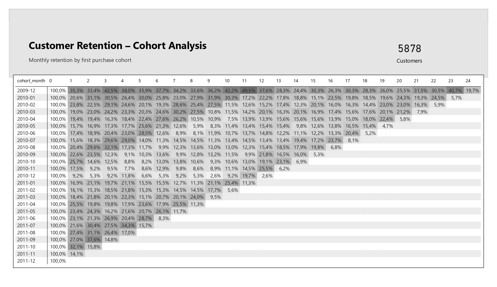

## Customer Retention & Segmentation Analysis

Sample page from the Power BI dashboard – Cohort Retention Analysis

## Project Overview

This project analyzes the use of transaction data for analyzing customer retention and purchasing behaviour for an online retailer.

Cohort analysis and RFM segmentation were implemented in SQL, with insights delivered through interactive Power BI dashboards.

## Dataset Description

This dataset includes prior transaction information, covering:
- Invoice-level records
- Customer identifiers
- Transaction timestamps
- Product quantities and unit prices
- Customer country information

Each row represents a single product purchased within an invoice. Customers can place multiple orders over time.

The raw dataset is not included in this repository due to file size limitations.

## Business Questions

The analysis addresses the following questions:
- How many customers return after their first purchase?
- How does retention evolve over time for different acquisition cohorts?
- How are customers distributed by recency, frequency, and monetary value?
- How is total revenue concentrated across customer segments?
- How are customers and revenue distributed across countries?

## SQL Data Pipeline

Data preparation and modeling were performed entirely in SQL using a layered approach:
- Raw transactional data ingestion
- Data cleaning and normalization
- Transaction-level revenue calculation
- Customer-level aggregation
- Cohort retention table creation
- RFM (Recency, Frequency, Monetary) feature calculation

Key SQL views include:

- `online_retail_customer_orders_clean_v`: cleaned transaction-level data with calculated line revenue
- `online_retail_customer_base_v`: customer-level aggregates (orders, revenue, recency)
- `online_retail_cohort_retention_v`: cohort-based retention metrics by acquisition month
- `online_retail_rfm_light_v`: customer segmentation variables based on RFM logic

## Power BI Dashboard Pages

The Power BI report is structured into four pages:

1. **Customer Retention (Cohort Analysis)**  
	Shows tables representing the percentage of customers who returned to purchase in the following months after their initial purchase separated into cohorts based on their purchase month.
	
2. **Business Overview**  
	Displays four of the global KPI metrics from the report: Total Revenue, Total Orders, Total Customers, and Average Order value.
	
3. **Customer Segmentation (RFM)**  
	Allows exploration of customers on a per-customer basis with Recency, Frequency and Money Buckets as well as interactive filters and a detailed customer table. 

4. **Customer Distribution**  
	Comparing customer counts and total revenue across countries using bar charts for each market's top customers.
	
A static PDF version of the dashboard is available in the `powerbi/` folder.

## Key Observations

- Each cohort's retention rate declines after the first purchase.
- Monthly cohorts have their own distinct retention rates by month.
- Customer revenues are not evenly distributed between customers, as a subset of them produces a disproportionately large amount of total revenue.
- The countries with the largest number of customers do not necessarily equate to those who produce the most total revenue.

## Tools & Technologies

- **SQL**: data cleaning, aggregation, cohort retention calculation, RFM feature engineering  
- **Power BI**: data modeling, DAX measures, interactive dashboards  

## Project Purpose

The objective of this project is to create a sample of work that will be included in my professional portfolio. The work demonstrates that I’ve developed the requisite skills to prepare data, analyze customer acquisition and behavior, & develop visualizations that are beneficial for business decision-making.
